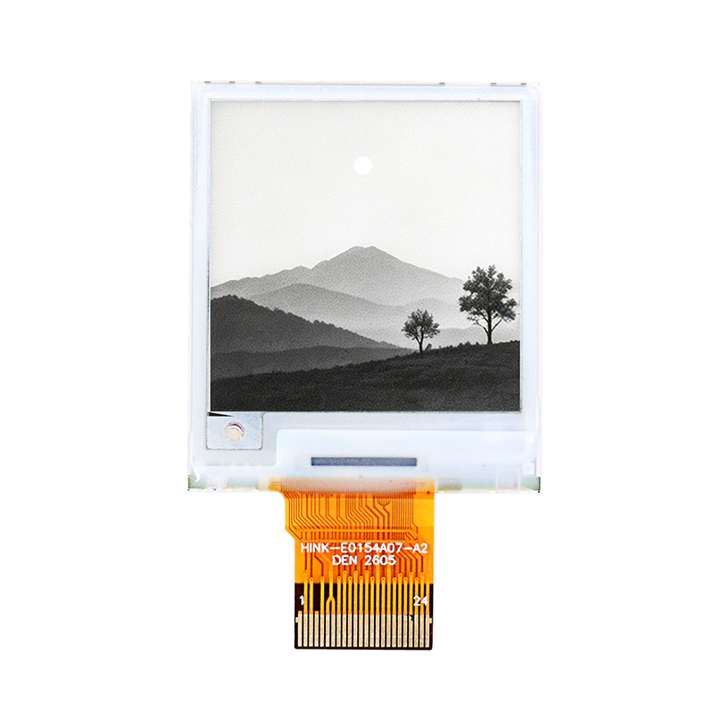

<p align="left"></p>

<h1 align="center">OSPTEK 1.54″ EPD Display 200×200 (EPD0154A281A0)</h1>

<p align="center"><b>EPD module · SPI · JD79660CA</b></p>

<p align="center"><a href="./README.md">简体中文</a> | English · <a href="../../README_EN.md">Family index</a></p>

<p align="center">
  
  
</p>

<p align="center"></p>

## Contents

- [Specifications](#specifications)
- [Resources](#resources)
- [Repository layout](#repository-layout)
- [Buy](#buy)
- [Support](#support)

---

## Specifications

| Item | Spec |
| ---- | ---- |
| Size | 1.54 inch |
| Type | EPD |
| Resolution | 200×200 |
| Outline | 37.32 x 31.80 x 0.86 mm |
| Active area | 27.00 x 27.00 mm |
| Interface | SPI |
| Driver IC | JD79660CA |
| Touch IC | — |

> Full outline, FPC definition, power, and timing follow the product datasheet / driver IC datasheet.

## Resources

| Category | File |
| ---- | ---- |
| Datasheet | [`EPD0154A281A0.pdf`](./datasheets/EPD0154A281A0.pdf) |

## Repository layout

```text
display-epd-1.54inch-200x200/ # repo root (nav: ../../README_EN.md; sample projects under root examples/)
└── versions/
    └── EPD0154A281A0/        # full materials for this part number
        ├── README.md
        ├── README_EN.md
        ├── osptek.yml
        ├── images/
        └── datasheets/       # product datasheet + driver/touch IC datasheets
```

## Buy

See the [repo home page](../../README_EN.md#where-to-buy).

## Support

See the [repo home page](../../README_EN.md#support).

---

<p align="center"><sub>© 2026 OSPTEK · Materials in this repository are licensed under CC BY 4.0</sub></p>
